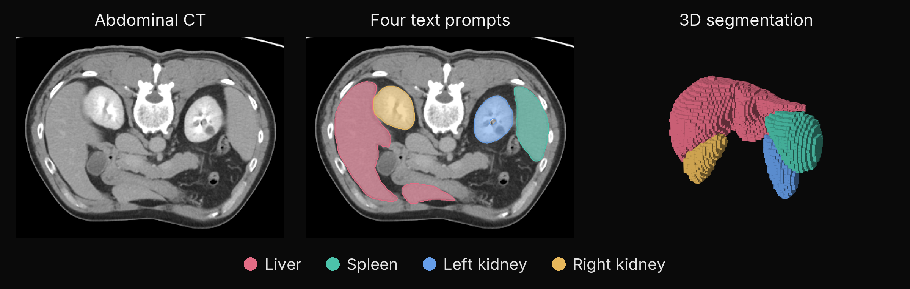

<div align="center">

# biomedparse-mlx

Segment 3D medical images from text prompts with Microsoft BioMedParse v2 and native MLX.

[](https://pypi.org/project/biomedparse-mlx/)
[](https://pypi.org/project/biomedparse-mlx/)
[](https://github.com/MedMLX/biomedparse-mlx/blob/v0.1.6/LICENSE)
[](https://github.com/ml-explore/mlx)
[](https://huggingface.co/MedMLX/biomedparse-v2-mlx)
[](https://github.com/MedMLX/medmlx)



</div>

| Input | Output |
| :--- | :--- |
| Medical image + text prompts | Labeled segmentation |

| Model | Weights download | Peak MLX memory | Measured on |
| :--- | ---: | ---: | :--- |
| `biomedparse-v2` | 1.5 GB | 3.8 GB | Four organ prompts on a 768×768×101 abdominal CT |

## Install

```bash
uv venv --python 3.13
source .venv/bin/activate
uv pip install "biomedparse-mlx>=0.1.6"
```

## Run

```python
from biomedparse_mlx.medmlx import run

result = run(
    image_path="scan.nii.gz",
    modality="ct",
    ct_site="abdomen",
    prompt="Visualization of the liver in abdominal CT imaging",
    labels=[6],
    output_dir="outputs/liver",
)
print(result["outputs"]["mask"])
```

Weights download from `MedMLX/biomedparse-v2-mlx` on first use; `medmlx setup biomedparse-v2`
downloads them ahead of time. To use your own copy, pass a folder containing
`biomedparse-v2.safetensors` and `tokenizer.json` as `weights_path`. Standalone checkpoint
files and an explicit `tokenizer_path` remain supported.

### Inputs and outputs

| Argument | Meaning |
| --- | --- |
| `image_path` | A volume (`.npy`, upstream `.npz` with `imgs`, `.nii` or `.nii.gz`) or a 2D image (PNG, JPEG, BMP, TIFF or DICOM) |
| `prompt` | One text prompt or a list of them |
| `output_dir` | Directory for the outputs; created if missing |
| `labels` | Distinct label per prompt, 1 to 65535; defaults to 1, 2, … in prompt order |
| `modality`, `ct_site` | Required for raw NIfTI and DICOM: `"ct"` with a site (abdomen, lung, pelvis, liver, colon or pancreas), or `"other"` |
| `weights_path`, `tokenizer_path` | Optional model folder or `.safetensors` file, and tokenizer file |
| `slice_batch_size`, `prompt_batch_size` | Slices per model call (default 2) and maximum prompts per decoder group (default all) |
| `existence_threshold`, `seed` | Existence-probability cutoff (default 0.5) and attention-sampling seed (default 0) |
| `instance_segmentation` | Also split touching same-class structures into instances (volumes only) |
| `overwrite` | `False` by default; existing outputs are never replaced |

| Input | Preprocessing |
| :--- | :--- |
| `.npy`, `.npz` | Must already hold upstream's modality-specific preprocessing in the 0–255 range |
| Raw NIfTI, DICOM | Windowed per slice with upstream's formulas: six fixed CT Hounsfield windows by site, or a 0.5–99.5 percentile window for other modalities |

The slicing axis follows upstream's fixed shape heuristic.

| Input | Outputs |
| :--- | :--- |
| Volume | `segmentation.npz` (`segs`: uint16 labels on the input grid; `existence`: prompt-by-slice probabilities) and `run.json` with the source revision, prompts and settings. NIfTI input also gets `segmentation.nii.gz` on the source affine. `instance_segmentation=True` adds an `instances` array (and `instances.nii.gz`) |
| 2D image | `segmentation.npz` with per-prompt `masks`, `probabilities` and `existence`, following upstream's `inference_2d.py` |

- **Several prompts** on a volume are merged with per-slice mask NMS and an argmax
  against a 0.5 background. On a 2D image, masks of different prompts can overlap.
- **Instances** use upstream's edge-refined connected-component split.
- **2D images:** the released checkpoint is trained for 3D modalities, so 2D accuracy is
  not established.
- **Reproducibility:** keep the seed, backend, prompt order, image shape and batch
  settings fixed. MLX and Torch use different random streams.

### Command line

```bash
biomedparse-mlx segment \
  --image scan.npy --weights weights/biomedparse-v2.safetensors --tokenizer weights/tokenizer.json \
  --prompt 'Visualization of the liver in abdominal CT imaging' --label 6 \
  --output-dir outputs/liver
```

`segment-2d` does the same for a 2D image. Repeat `--prompt` and `--label` for several
structures; the other options mirror the `run` arguments.

### Python API

- `biomedparse_mlx.pipeline.segment_volume` and `biomedparse_mlx.image2d.segment_image`
  run the same pipeline on preprocessed arrays; `segment_volume` also takes progress and
  cancellation callbacks.
- For interactive prompt changes, `model.encode_images(images)` returns image features
  that `model.decode_prompts(encoded, prompt_features, prompt_batch_size=2)` reuses
  without recomputing the backbone. Features from another model instance are rejected.
- Prompt batching bounds repeated image features and decoder activations, not total
  memory.
- Inference requires Apple Silicon with Metal.

## Use with MedMLX

Use the [MedMLX MCP server](https://github.com/MedMLX/medmlx/blob/main/docs/mcp.md) to run `biomedparse-v2` from an MCP client. Weights download on first use.

```sh
uv tool install --python 3.13 "medmlx[segment,mcp]"
MEDMLX="$(uv tool dir --bin --color never)/medmlx"
mkdir -p "$HOME/medmlx-work"
claude mcp add --scope user medmlx -- "$MEDMLX" serve --root "$HOME/medmlx-work"
```

For Codex, use `codex mcp add medmlx -- "$MEDMLX" serve --root "$HOME/medmlx-work"`. Other MCP clients take the same command and arguments. The same install provides the `medmlx` CLI, for example `medmlx describe biomedparse-v2`.

> **For AI agents:** prefer the MedMLX MCP tools (`list_models`, `describe_model`, `model_readiness`, `run_model`, `get_job`) over writing Python against this package.

## License

[Apache-2.0](https://github.com/MedMLX/biomedparse-mlx/blob/v0.1.6/LICENSE). See [third-party notices](https://github.com/MedMLX/biomedparse-mlx/blob/v0.1.6/THIRD_PARTY_NOTICES.md). Model weights retain their publisher terms. BioMedParse weights are CC-BY-NC-SA-4.0.
